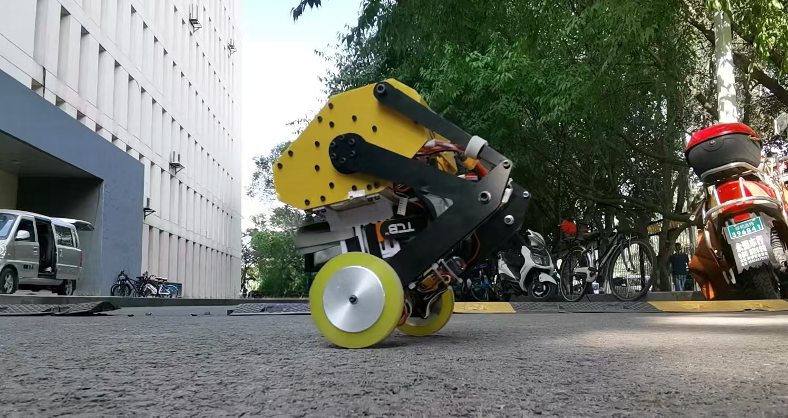

# Tracker

机器人控制 · 嵌入式 · 具身智能

[博客](https://www.cnblogs.com/startrack) · [主页](https://track-tech.github.io) · [B 站](https://space.bilibili.com/21198864) · [GitHub](https://github.com/track-tech)

---

一个妄想点满技能树的人。做轮腿机器人、人形运动控制和机器人遥操作 ——
喜欢把一个想法从连杆、电机、控制律一路做到实机跑起来。

现在主要在两件事上：给机器人做一套公开的**遥操作协议**（Uni-RoboController），
以及把世界模型的**强化学习**落到 28-DoF 人形上（SuperMimic @ RP1）。

## 精选项目

### 启明-1 · 四连杆轮腿机器人

本科毕业设计。3mm 玻纤板车身 + 用 Pyslvs 拟合的四连杆，小米 CyberGear 关节、DJI C610 + M2006 轮驱，STM32H723 + FreeRTOS 跑电控，纯 PID 实现轮平衡、重心自适应、主动悬挂与跳跃。

`C` `STM32H723` `FreeRTOS` `GPL-3.0`　｜　74 ★ · 12 fork　｜　[仓库](https://github.com/track-tech/Venus-1__Four-link-wheel-legged-robot) · [测试视频](https://space.bilibili.com/21198864/lists/4193332?type=series)

  

### SuperMimic @ RoboParty RP1

把 Uni-SuperMimic 移植到 28-DoF 人形 RoboParty RP1，并用同一份代码支持 Unitree G1 / RPO / Mars_v3。40 段 LAFAN1 动作的确定性评测：RP1 **0.758**（3/40 失败），G1 参照 0.774。

`Python` `PyTorch 2.9` `MuJoCo Warp` `MIT`　｜　[仓库](https://github.com/track-tech/SuperMimic-RoboParty-RP1-)

### Uni-RoboController

开源机器人遥操作协议 + Android 操作端 + 一致性测试。局域网自动发现、UDP 实时通道（AES-GCM）、H.264 视频、URDF 模型与关节状态同步；附 mock 服务端（含故障注入）与最小参考 Agent，第三方实现可用 CTS 自测。

`Python` `C++` `Android` `URDF`　｜　[仓库](https://github.com/track-tech/Uni-RoboController)

### Simple-ESP32C3-Controller

为调试机体做的 ESP-NOW 无线遥控改装：9.9 元的玩具遥控器换成 ESP32-C3 主控，做一阶互补滤波后直接把控制量发给机器人。

`C++` `ESP32-C3` `ESP-NOW`　｜　3 ★　｜　[仓库](https://github.com/track-tech/Simple-ESP32C3-Controller)

## 技术栈

- **控制与嵌入式**　`C` / `C++` / `STM32H723` / `FreeRTOS` / `micro-ROS` / `CAN` / `ESP-IDF` / `PID`
- **仿真与学习**　`Python` / `PyTorch` / `MuJoCo Warp` / `LAFAN1` 动作重定向 / 强化学习训练与评测
- **机械与工具**　`SolidWorks` / `Pyslvs` 连杆综合 / `Linux` / `Git` / `Docker`

## 机器人形态

轮腿（启明-1）· 人形（RoboParty RP1 / Unitree G1 / RPO）· 点足（Mars_v3）· 多形态遥操作（Uni-RoboController：四足 / 人形 / 轮足 / 机械臂）

---

  把想法做成能跑的东西 · It works on my robot.

