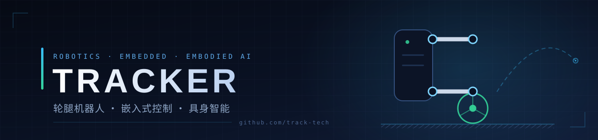

  

 

## Hi，我是 Tracker 👋

**一个妄想点满技能树的人。** 从连杆结构和电机驱动，到控制律、通信协议，再一路摸到强化学习 ——
我享受的事情很简单：把一个想法做成**真的能跑、能跳、别人也能复刻**的东西。

> **EN** · Robotics & embedded developer. Wheel-legged robots, an open teleoperation protocol,
> and humanoid motion learning. Everything I ship is open source.

- 🔭 &nbsp;**主线**：轮腿 / 人形机器人的控制与遥操作
- 🌱 &nbsp;**正在点**：强化学习 × 机器人（sim2real）
- ✍️ &nbsp;**写点东西**：[博客园](https://www.cnblogs.com/startrack) · [个人主页](https://track-tech.github.io) · [B 站](https://space.bilibili.com/21198864)

---

## 🧭 我在做什么

| 方向 | 在做的事 | 关键词 |
| :-- | :-- | :-- |
| **机器人本体与控制** | 轮腿 / 人形机器人的本体控制：从连杆机构、电机选型到平衡、悬挂、跳跃与落地缓冲 | `STM32H723` `FreeRTOS` `CAN` `PID` |
| **遥操作与协议** | `Uni-RoboController`：公开协议 + Android 操作端 + 一致性测试（CTS），让不同形态的机器人被同一个 App 操作 | `UDP` `H.264` `URDF` `Android` |
| **具身智能** | 把 SuperMimic 的世界模型强化学习搬到 28-DoF 人形 `RP1` 上，一套代码在 4 种机器人之间切换 | `PyTorch` `MuJoCo Warp` `LAFAN1` |

## 🚀 精选项目

### ⚙️ [启明-1 · 四连杆轮腿机器人](https://github.com/track-tech/Venus-1__Four-link-wheel-legged-robot)

本科毕业设计 ｜ `C` · `STM32H723` · `FreeRTOS` · `GPL-3.0` ｜ **74 ★ · 12 fork**

- 3mm 玻纤板车身 + 用 Pyslvs 拟合的四连杆，关节用小米 CyberGear，轮驱用大疆 C610 + M2006
- 纯 PID 实现轮平衡与腿控：重心自适应、主动悬挂（Roll 自稳定）、下落缓冲、跳跃
- 机械 / 电控 / 代码全部开源，附完整的设计推导与测试记录

[📄 项目详情](https://github.com/track-tech/Venus-1__Four-link-wheel-legged-robot) · [🎬 测试视频合集](https://space.bilibili.com/21198864/lists/4193332?type=series)

### 🤖 [SuperMimic on RoboParty RP1](https://github.com/track-tech/SuperMimic-RoboParty-RP1-)

把 [Uni-SuperMimic](https://github.com/Motphys/Uni-SuperMimic)（SuperMimic 的独立复现）移植到 28-DoF 人形 **RoboParty RP1**，
并让同一份代码同时支持 **Unitree G1 / RPO / Mars_v3** 四种机器人。

- 40 段 LAFAN1 动作的确定性评测：RP1 **0.758**（3/40 失败），对照 G1 0.774（5/40）
- MuJoCo Warp 上训练 + 动作重定向，`SUPERMIMIC_ROBOT={g1|rp1|rpo|mars}` 一键切换 profile
- `Python` · `PyTorch 2.9` · `MuJoCo Warp` · `MIT`

### 📡 [Uni-RoboController](https://github.com/track-tech/Uni-RoboController)

开源机器人**遥操作协议 + Android 操作端 + 一致性测试（CTS）**：机器人端实现协议，就能被同一个 App 发现、配对、操控。

- 局域网自动发现、UDP 实时通道（AES-GCM 加密）、H.264 视频、URDF 模型与关节状态同步
- 提供 mock 服务端（含故障注入）+ 最小参考 Agent，第三方实现可以用 CTS 自测
- 四足 / 人形 / 轮足 / 机械臂通过「能力描述 + 命令接口 + URDF」接入
- `Python` · `C++` · `Android` ｜ 状态：设计阶段 v0.1，范围与 ADR 已落地

## 🧩 其他项目

| 项目 | 一句话 | 栈 |
| :-- | :-- | :-- |
| [MeowFish Cloud](https://github.com/track-tech/meowfish-cloud) | 跑在 Cloudflare Workers 上的 AI 角色扮演 Agent：角色卡、多引擎联网、内置 SSH 客户端与 Web 终端，云端零持久化（[在线试试](https://meowfish-agent.kdns.fr/)） | `TypeScript` |
| [astrbot_plugin_ruying](https://github.com/track-tech/astrbot_plugin_ruying) | 让 AI 机器人通过无线 ADB「看见」并操作你的安卓手机：截屏、控件坐标、点击滑动、打开应用 | `Python` |
| [astrbot_plugin_server_monitor](https://github.com/track-tech/astrbot_plugin_server_monitor) | AstrBot 的服务器监控看板：拖拽式面板、SSH / Agent 双端采集、Docker、模型用量与余额、网页 SSH 终端 | `Python` |
| [Simple-ESP32C3-Controller](https://github.com/track-tech/Simple-ESP32C3-Controller) | 把 9.9 元的玩具遥控器改成 ESP-NOW 无线手柄 | `C++` |
| [ESP32C3 + ST7789V + FT6236U](https://github.com/track-tech/ESP32C3-st7789v-ft6236u-arduino-touch-OpenSource) | 在 ESP32-C3 上跑 LVGL 8.3 的电容触摸屏示例 | `C` `LVGL` |
| [IMAU_Course_Sharing](https://github.com/track-tech/IMAU_Course_Sharing) | 内蒙古农业大学课程攻略共享计划：把口口相传的课程经验变成公开资料 | `Markdown` |

## 🛠 技术栈

| 分层 | 常用 |
| :-- | :-- |
| **语言** | `C` · `C++` · `Python` · `TypeScript` · `Shell` |
| **控制与嵌入式** | `STM32 HAL` · `FreeRTOS` · `micro-ROS` · `CAN` · `ESP-IDF` · `Arduino` · `PID` |
| **机器人** | 电机驱动（CyberGear / DJI C610 + M2006） · 连杆综合与运动学（Pyslvs） · 轮腿 / 人形 / 点足平台 · 遥操作与 CTS |
| **具身智能** | `PyTorch` · `MuJoCo Warp` · LAFAN1 动作重定向 · 强化学习训练与评测 |
| **工具** | `Linux` · `Git` · `SolidWorks` · `Cloudflare Workers` · `Android ADB` |

## 🔗 找到我

| 渠道 | 地址 |
| :-- | :-- |
| 博客 | [__TRACKER · 博客园](https://www.cnblogs.com/startrack) |
| 主页 | [track-tech.github.io](https://track-tech.github.io) |
| 视频 | [B 站 · 机器人测试合集](https://space.bilibili.com/21198864) |
| 代码 | [github.com/track-tech](https://github.com/track-tech) |

想做轮腿、人形或者遥操作相关的东西？欢迎开 [Issue](https://github.com/track-tech/track-tech/issues) 找我聊。

  把想法做成能跑的东西 · <i>It works on my robot.</i>

